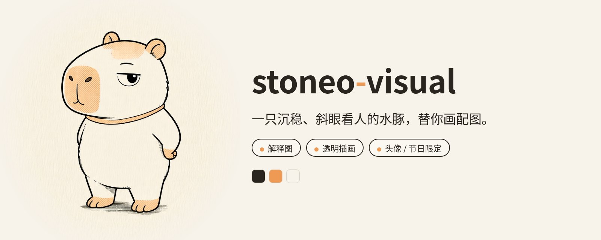
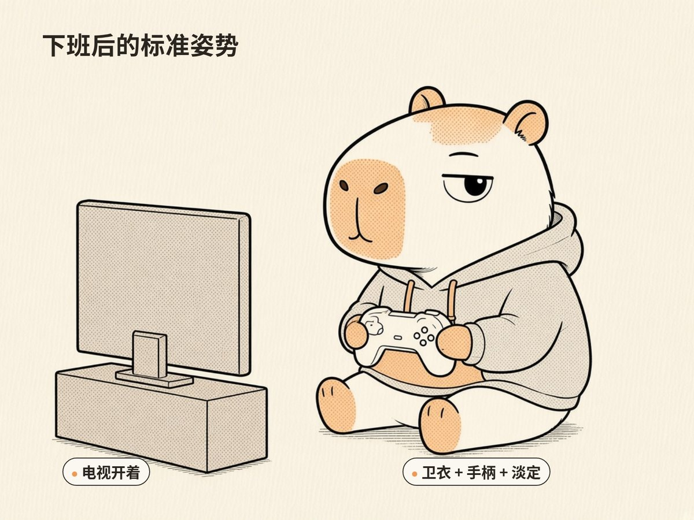
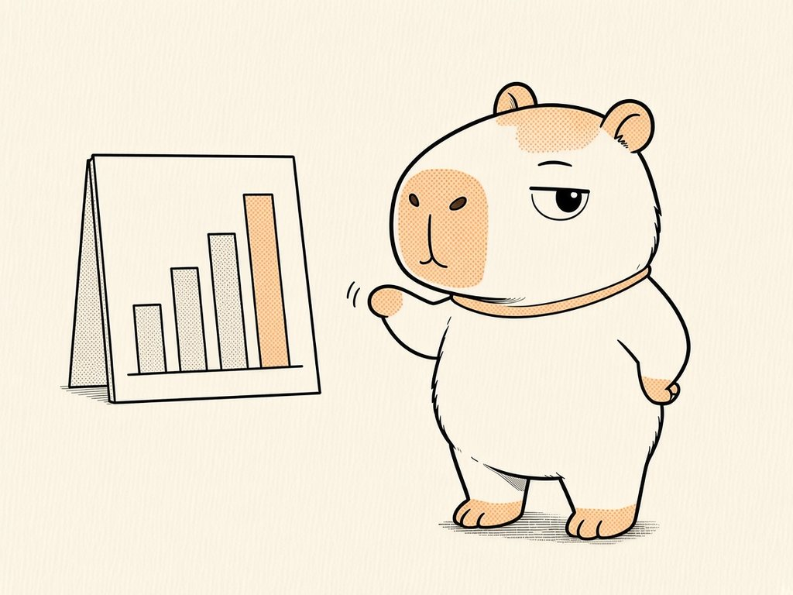
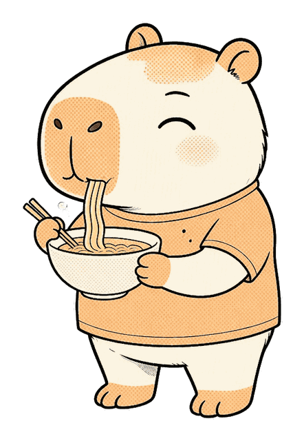
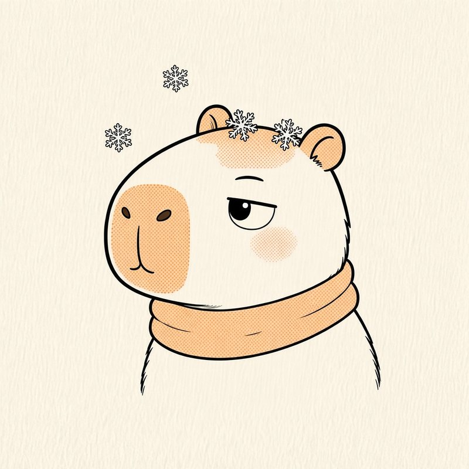
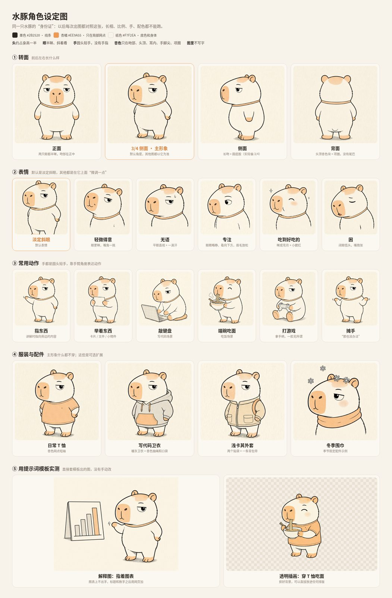

<p align="center">
  
</p>

<p align="center"><b>一只沉稳、斜眼看人的水豚，用克制的漫画墨线和杏色网点，替你画解释图、插画和头像。</b></p>

stoneo-visual 是一个给 AI Agent 用的出图 Skill。它把一只固定的水豚角色、一套固定的画法和一条固定的出图流程打包在一起：每次都以参考图为底让宿主的生图工具做 edit，所以不管画什么场景，出来的都是同一只水豚、同一种味道。图里不生成任何文字，标题和标签都用 HTML 后加，不会有错字。

## 效果展示

### 解释图

<p align="center">
  
  
</p>

左图：穿卫衣打游戏，标题和两个标签是用 HTML 叠上去的。右图：用短圆手指着一张柱状图，图表上没有字，方便你之后加上自己的数据。

### 透明插画与头像

<p align="center">
  
  &nbsp;&nbsp;
  
</p>

左图：透明背景的吃面插画，可以直接放进文章、卡片或幻灯片。右图：冬季限定头像，戴着围巾，对头上的雪淡定地斜眼。

## 能做什么

- **解释图**：水豚在一个完整场景里演示一件事（比较、流程、状态），画面留出空白，之后用 HTML 加标题和标签。
- **透明插画**：只画水豚和必要的道具，绿幕出图后自动抠成透明 PNG，拿去任何排版里用。
- **头像 / 季节节日限定**：方形构图，圆形裁切也不会切到耳朵，并会检查 64px 和 32px 下还认不认得出来。主形象换上围巾、草帽等配件，就是季节和节日版本。

## 怎么用

### 安装

把整个 `stoneo-visual` 文件夹放进你所用 Agent 的 skills 目录（不同宿主的位置不一样，以宿主文档为准），然后让宿主重新加载 Skill。

这是私有仓库，需要有访问权限才能克隆：

```bash
git clone git@github.com:sfw003/stoneo-visual.git
# 或
git clone https://github.com/sfw003/stoneo-visual.git
```

### 直接这样说

```text
用 stoneo-visual 画一张解释图：水豚指着一张上升的柱状图，标题写“这个月的进度”。
```

```text
用 stoneo-visual 画一个透明背景的插画：水豚戴着耳机敲键盘，用来放在文章开头。
```

```text
用 stoneo-visual 给我出一个春节限定头像，给我 3 个方案对比一下。
```

默认会给 3 个方案，做成一张对比板：每个方案一行，包括原图、一句讲解（用了哪些元素、好在哪、代价是什么），以及放进实际用途里的效果。头像会给出圆形裁切、64px 和 32px 预览，以及浅色、深色界面下的样子；配图会放进文章和卡片里演示。推荐的方案会单独标出来。你选定后，会单独导出 1024×1024 的高清 PNG；解释图按原比例导出。

完整规则、提示词模板和验收清单都在 [`SKILL.md`](./SKILL.md) 里。

## 角色和风格

<p align="center">
  
</p>

- **性格**：沉稳，带一点冷幽默。默认表情是半眯着眼、斜着看人。
- **外形**：圆胖的纸白身体，大圆角方头，杏色网点的钝吻部。手是像星之卡比那样的圆头短手，没有手指。
- **主形象什么都不穿**。可选的服装有 T 恤、写代码卫衣和浅卡其外套；配件有耳机、头顶小橘子和冬季围巾。
- **风格**：大面积留白，墨线干净有力，用圆形网点代替渐变，杏色只用在局部。

| 颜色 | Hex | 用在哪里 |
|---|---|---|
| 墨色 | `#2B2520` | 所有线条 |
| 杏橘 | `#EE9A55` | 局部网点：吻部、头顶、耳内、手脚尖、项圈 |
| 纸色 | `#F7F2EA` | 背景和身体 |

## 目录结构

```text
stoneo-visual/
├── SKILL.md                 # 入口：角色、风格、流程、文件索引
├── references/              # 提示词模板、参考图选择、验收与常见问题、
│                            # 输出规范、季节/节日限定、HTML 加字、完整示例
├── assets/
│   ├── refs/                # 出图用的参考图（主形象母版、转面、表情、动作、服装、配件）
│   ├── templates/           # 方案对比板、解释图加标签的 HTML 模板
│   └── readme/              # 本页配图
├── scripts/                 # cutout.py 抠图、avatar_preview.py 头像检查、render_board.py 渲染
└── agents/openai.yaml
```

`workbench/` 是本地的过程文件目录，已经被 `.gitignore` 忽略，不会进仓库。

## 已知局限

- **纯侧面画不出来**：模型总会画成偏 3/4 的角度。
- **「专注」表情**必须带上对应的参考图，只写文字描述会画回默认的半眯眼，或者变成瞪人。
- **手里拿东西时容易长出手指**：必须加短圆手参考图。事后局部修改往往修不掉，只能重新出图。
- **32px 头像**基本看不清斜眼。64px 没问题。
- **季节/节日例子大多没实测**：目前只有冬季实际出过图，其余的例子还没验证。春节容易被自动加上红色和"福"字。
- **小橘子、耳机、背包带、衣服颜色**偶尔会跑偏，修正写法见 `references/troubleshooting.md`。
- **依赖宿主能力**：需要宿主有生图（能以参考图做 edit）和读图能力。脚本需要 Python 3、Pillow 和 Chrome/Chromium。

## 致谢和许可

- 结构和写法参考了 [oil-visual](https://github.com/oil-oil/oil-visual)，感谢原作者。
- `scripts/cutout.py` 改编自 oil-visual 的同名脚本，遵守其 MIT 许可，原许可证见 [`scripts/LICENSE-oil-visual`](./scripts/LICENSE-oil-visual)。
- 本仓库其余内容（角色形象、参考图、文档）**暂未开源，保留所有权利**。
